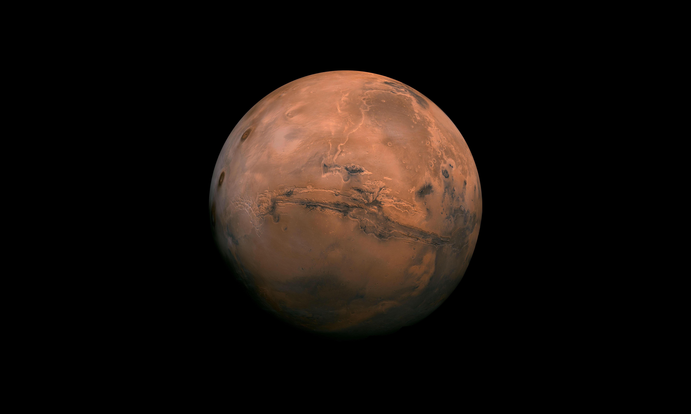

 

  

  # PROJECT ASTRA

  ### Beyond Earth. Into the Unknown.

  *Exploring ideas. Engineering possibilities. Shaping the future of space exploration.*

   

  
  
  

   

  **[About Us](#about-us) · [Our Mission](#our-current-mission) · [Mars Exploration](#the-future-of-human-exploration-on-mars) · [Our Vision](#our-vision) · [Contact](#contact)**

---

## 🌌 About Us

**Project ASTRA is an emerging research and technology initiative driven by curiosity, scientific exploration, and engineering innovation.**

We are a team of individuals brought together by a shared interest in technology, space science, and the possibilities that lie beyond our planet.

Our interests span software engineering, scientific research, artificial intelligence, data visualization, and emerging technologies.

We believe that some of humanity's greatest achievements begin with asking questions that seem impossible to answer.

ASTRA aims to provide a collaborative environment where ideas can evolve into research, research can inspire engineering, and engineering can lead to meaningful solutions.

We are starting small, learning continuously, and building with a much bigger horizon in mind.

---

##  Our Current Mission

  

  ### MISSION 001

  # Interplanetary Survival Guide: Martian Map

  **Destination: Jezero Crater, Mars**

  NASA Space Apps Challenge 2026

### The Mission

Humanity has spent decades studying Mars through orbiters, landers, and robotic explorers. Yet, understanding how humans might navigate, survive, and explore an entirely different planetary environment remains one of the greatest challenges of future space exploration.

As part of the NASA Space Apps Challenge 2026, our first mission is to develop an **Interplanetary Survival Guide: Martian Map**.

Our focus is Jezero Crater, a scientifically significant region on Mars and the exploration site of NASA's Perseverance rover.

We aim to transform publicly available Martian geographical and scientific information into an interactive exploration platform that helps people understand the planet beyond a conventional map.

### What We Want to Explore

- **Martian Geography:** Explore the surface, geological structures, craters, and significant terrain features of Jezero Crater.
- **Terrain Visualization:** Investigate interactive 2D and 3D representations of the Martian landscape.
- **Scientific Data Integration:** Utilize publicly available NASA datasets, imagery, and planetary information.
- **Environmental Awareness:** Explore Martian environmental conditions and their implications for future exploration.
- **Exploration Planning:** Investigate terrain awareness, geographical context, and route-related information.
- **Survival Considerations:** Understand the environmental and logistical challenges that future human explorers may encounter.

Our objective is not simply to recreate the geography of Mars, but to investigate how scientific information can become an understandable and useful exploration guide.

**We believe that before humanity can explore another world, it must first learn how to understand it.**

---

## 🚀 The Future of Human Exploration on Mars

Mars is no longer just a distant object of scientific curiosity. It is an important destination in the long-term plans of space agencies and commercial space companies.

Organizations such as NASA and SpaceX are exploring different approaches to making human exploration of Mars possible.

We follow these developments because understanding the future of planetary exploration helps us understand the problems our technology may eventually need to address.

### 1. NASA — Moon to Mars

NASA's Moon to Mars Architecture outlines a long-term roadmap for expanding human exploration beyond Earth.

Rather than immediately attempting a human mission to Mars, NASA follows a progressive approach: developing and demonstrating technologies through lunar exploration before undertaking increasingly complex missions to the Red Planet.

Some major areas of development include:

- **Artemis Program:** Returning astronauts to the Moon and establishing experience for longer-duration exploration.
- **Deep Space Transportation:** Developing the systems needed to transport astronauts across vast interplanetary distances.
- **Mars Habitats:** Investigating safe living environments that can protect astronauts from the Martian environment.
- **Power Generation:** Developing reliable energy systems, including nuclear fission power, for surface operations.
- **Communication Systems:** Exploring advanced communication technologies, including laser communications.
- **Resource Utilization:** Investigating ways to use resources available beyond Earth.
- **Human Health:** Understanding the effects of radiation, reduced gravity, and long-duration spaceflight.

NASA's long-term objective is to establish the capabilities required for humans to travel to Mars, conduct scientific exploration, and safely return to Earth.

Official resource: https://www.nasa.gov/MoonToMarsArchitecture/

### 2. SpaceX — Starship and Making Humanity Multiplanetary

SpaceX has a different but equally ambitious vision: making humanity a multiplanetary civilization.

Its Starship and Super Heavy transportation system is being developed as a fully reusable launch and transportation system designed for missions to Earth orbit, the Moon, Mars, and beyond.

SpaceX's published Mars ambitions include:

- **Reusable Transportation:** Developing a transportation system capable of carrying substantial cargo and eventually crew to Mars.
- **Interplanetary Refueling:** Using orbital refueling to support long-distance transportation missions.
- **Cargo Missions:** Delivering equipment, supplies, and infrastructure for future Martian exploration.
- **Surface Infrastructure:** Establishing power generation, landing facilities, habitats, and other essential systems.
- **Resource Utilization:** Investigating the use of Martian resources, including the potential production of methane and oxygen.
- **Long-Term Settlement:** Working toward its vision of establishing a self-sustaining human settlement on Mars.

SpaceX currently describes its Mars cargo mission ambitions as starting no earlier than 2028. These are company-stated plans, not confirmed operational missions.

Official resource: https://www.spacex.com/mars/

### 3. Why This Matters to ASTRA

These ambitions introduce an important question:

**How do we prepare to explore an environment that is fundamentally different from Earth?**

Future explorers will need more than transportation systems and spacecraft. They will also need scientific information, geographical understanding, environmental awareness, reliable communication, and tools that help them make informed decisions.

This is where we believe planetary mapping and interactive scientific visualization can contribute.

Our current Martian Map mission is one small step toward exploring these possibilities.

---

## 🌠 Our Vision

We envision a future where technology makes the exploration and understanding of other worlds increasingly accessible.

Our long-term vision extends beyond a single hackathon or planetary mapping project.

We want to explore opportunities across:

| Research Area | Our Interest |
|---|---|
| Space Science | Planetary exploration and scientific discovery |
| Artificial Intelligence | Intelligent systems and research applications |
| Software Engineering | Building meaningful and scalable technologies |
| Scientific Visualization | Making complex scientific information understandable |
| Planetary Technologies | Tools for understanding extraterrestrial environments |
| Open Research | Sharing knowledge and contributing to the wider community |

Mars is our starting point, but our curiosity extends across the universe.

---

## 🛰️ Our Approach

We believe that meaningful innovation requires more than writing code.

Our approach combines scientific understanding with practical engineering.

**01 — Research**

Understand the problem, investigate existing scientific knowledge, and identify reliable datasets and resources.

**02 — Exploration**

Examine different approaches, experiment with ideas, and identify opportunities for innovation.

**03 — Engineering**

Transform research findings into practical technological solutions.

**04 — Visualization**

Make complex information accessible through intuitive interfaces, interactive maps, and visual experiences.

**05 — Collaboration**

Share knowledge, document discoveries, and improve our work through continuous collaboration.

---

## 🔬 Research & Technology Interests

Our technical interests include:

- Web Development and Interactive Applications
- Geospatial Technologies and Planetary Mapping
- 2D and 3D Scientific Visualization
- Artificial Intelligence and Machine Learning
- Scientific Data Processing and Analysis
- NASA Open Data, APIs, and Research Resources
- Human-Computer Interaction

Our technology stack and research methods will evolve according to the needs of each mission.

---

## 📡 Open Research & Collaboration

We believe that scientific progress benefits from collaboration and the open exchange of knowledge.

This GitHub organization/repository serves as a shared space for documenting our research, ideas, experiments, technical developments, and project progress.

We aim to:

- Document research and discoveries.
- Share useful scientific resources.
- Maintain transparent development practices.
- Collaborate with developers and researchers.
- Contribute to open-source projects and communities.
- Learn from existing scientific and engineering work.

We welcome curiosity, constructive discussions, and opportunities to collaborate.

---

## 🗺️ Our Journey

| Milestone | Status |
|---|---|
| Project ASTRA Formation | In Progress |
| NASA Space Apps Challenge 2026 | Participating |
| Challenge Selection | Completed |
| Initial Research | In Progress |
| Mission Concept Development | In Progress |
| Technical Development | Upcoming |
| Testing & Refinement | Upcoming |
| Project Presentation | Upcoming |

---

##  Beyond Our First Mission

**Mission 001 is only the beginning.**

We want ASTRA to grow into an environment where research, technology, and curiosity come together to address interesting problems.

As our team evolves, we hope to investigate new scientific questions, develop meaningful applications, and contribute to technological communities.

The universe is vast, and there is still so much to understand.

We are here to explore those possibilities, one mission at a time.

---

## 📬 Contact & Connect

Have an idea, research opportunity, or collaboration in mind?

We would be glad to connect.

**Project ASTRA — Team Lead**

**Prince Timilsina**

- Instagram: [@prince.env](https://www.instagram.com/prince.env)
- Email: [timilsinaprince.js@gmail.com](mailto:timilsinaprince.js@gmail.com)
- GitHub: [@PrinceTimilsina](https://github.com/PrinceTimilsina)

For team-related discussions, research coordination, collaboration, and general inquiries, feel free to reach out through the channels above.

---

  # PROJECT ASTRA

  ### Beyond Earth. Into the Unknown.

  *One mission. Countless possibilities.*

   

  **Built with curiosity, collaboration, and a passion for exploration.**

   

  Participating in NASA Space Apps Challenge 2026 · Bhaktapur, Nepal

    
  NASA and SpaceX names, logos, imagery, and referenced materials belong to their respective owners.
 
  © 2026 Project ASTRA. All rights reserved for original branding, logo, and original content, subject to the applicable repository license and third-party rights.

   

