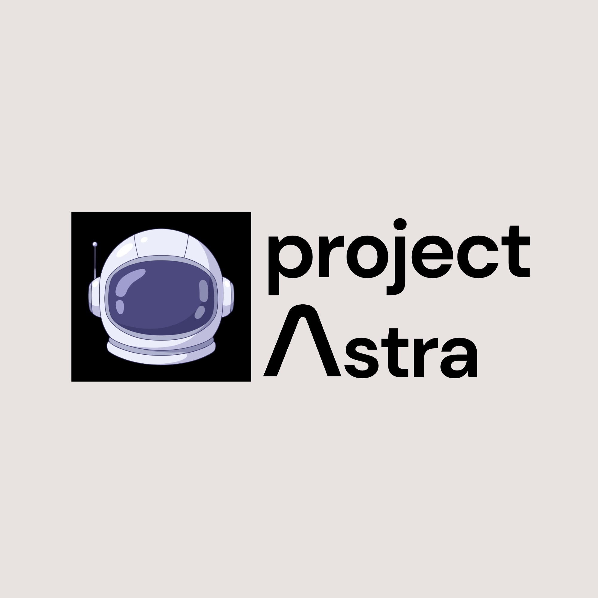

 

  

  # PROJECT ASTRA

  **Beyond Earth. Into the Unknown.**

  *Exploring ideas. Engineering possibilities. Shaping the future of space exploration.*

   

  
  
  

  **[Our Mission](#-our-current-mission) · [About Us](#-who-we-are) · [Our Vision](#-our-vision) · [Our Approach](#-our-approach)**

---

##  Our Current Mission

### Interplanetary Survival Guide: Martian Map

**Our mission is to rethink how humans navigate, understand, and prepare for exploration beyond Earth.**

As part of the **NASA Space Apps Challenge 2026**, Project ASTRA is working on the challenge *Interplanetary Survival Guide: Martian Map*.

Our initial mission focuses on **Jezero Crater, Mars**, an extraordinary region with significant scientific importance and a history of exploration by NASA's Perseverance rover.

We aim to transform scientific and geographical information about the Martian surface into an interactive, informative, and exploration-oriented survival guide.

Rather than simply presenting a map, we envision a platform that helps users understand the Martian environment, explore its terrain, identify relevant geographical features, and investigate the challenges associated with future human exploration.

We believe that preparing for another world begins with understanding it.

---

## Who We Are??

**Project ASTRA is a team driven by curiosity, research, technology, and a shared ambition to explore possibilities beyond our planet.**

We bring together individuals with different interests, perspectives, and technical abilities to investigate challenging problems and develop meaningful solutions.

Our interests extend across space science, software engineering, data visualization, artificial intelligence, and emerging technologies.

We believe innovation happens when scientific curiosity meets practical engineering.

ASTRA is more than a single project or competition. It is an evolving initiative through which we want to learn, experiment, collaborate, and contribute to the broader technological community.

---

## Our Vision

We envision a future where exploring other worlds becomes increasingly understandable, accessible, and achievable through technology.

Our long-term interests include:

- **Space Exploration:** Understanding planetary environments and the challenges of interplanetary missions.
- **Research & Innovation:** Exploring scientific questions and turning research into practical applications.
- **Software Engineering:** Building useful, interactive, and scalable technological solutions.
- **Artificial Intelligence:** Investigating how intelligent systems can support scientific exploration and decision-making.
- **Open Collaboration:** Sharing knowledge, research, and ideas with the wider community.

Our current focus is Mars, but our curiosity does not end there.

---

## 🛰️ Our Approach

We believe meaningful solutions require more than writing code.

Our approach combines:

1. **Research:** Understanding the scientific background, available datasets, and actual problem.
2. **Exploration:** Investigating possible approaches and identifying opportunities for innovation.
3. **Engineering:** Translating research findings into practical software solutions.
4. **Visualization:** Making complex information understandable through intuitive interfaces and interactive experiences.
5. **Collaboration:** Working together, documenting findings, and continuously improving our ideas.

---

## 🔭 What We're Exploring

Our current research and development interests include:

| Area | Focus |
|---|---|
| Planetary Mapping | Understanding Martian geography and surface features |
| Terrain Visualization | Exploring 2D and 3D representations of planetary terrain |
| Scientific Data | Working with NASA's open scientific datasets |
| Environmental Analysis | Investigating relevant Martian environmental conditions |
| Exploration Planning | Exploring terrain awareness and route-related information |
| Interactive Systems | Developing accessible, research-driven web experiences |

These are areas of exploration and development, not claims of completed functionality.

---

## 🧪 Our First Mission: Mars

<b>Why Jezero Crater?</b>

Jezero Crater is a fascinating location on Mars, particularly because of its ancient geological history and its importance to the search for evidence of past microbial life.

It is also the landing and exploration region of NASA's Perseverance rover.

For ASTRA, Jezero provides a meaningful starting point for investigating planetary terrain, scientific datasets, and the possibilities of future exploration.

Our work will draw upon publicly available scientific information and NASA resources to investigate how planetary data can be transformed into useful exploration tools.

---

## 🤝 Collaboration & Open Research

We believe knowledge should be shared.

This repository serves as a collaborative space for our team's research, documentation, ideas, experiments, and development progress.

We aim to maintain transparency throughout our journey by documenting what we discover, what we build, and what we learn.

Our research and development process is an opportunity to learn from one another and contribute to the broader open-source and space-technology community.

---

## 🛠️ Technology & Resources

Our technology choices will evolve according to the requirements of each mission.

Our areas of technical interest include:

- Web Development & Interactive Interfaces
- Scientific Data Visualization
- Geospatial Technologies
- 3D Visualization
- NASA Open Data & APIs
- Artificial Intelligence and Data Analysis

---

## 🌍 Beyond This Mission

Mars is where our journey begins, not necessarily where it ends.

We hope Project ASTRA will continue to evolve through research, experimentation, collaboration, and the development of meaningful technological solutions.

Every mission starts with a question. Ours begins with a simple one:

**What will it take to make humanity a multiplanetary civilization?**

---

  ### PROJECT ASTRA

  **Beyond Earth. Into the Unknown.**

  *One mission. Countless possibilities.*

   

  **Built with curiosity, collaboration, and a passion for exploration.**

  Participating in NASA Space Apps Challenge 2026 · Bhaktapur, Nepal
   Copyright

